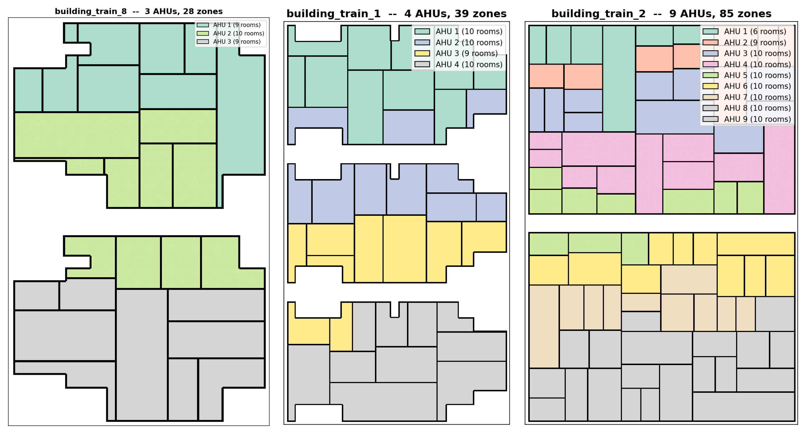

# One Controller for Every Building
### An explainer on the NeurIPS 2026 Smart Buildings competition, and our plan to win it with discovered physics

*Based on the starter kit `smart-buildings-2026/starter-kit` · Competition page: <https://www.kaggle.com/competitions/neurips-2026-smart-buildings/>*

---

## Summary

Heating, cooling and ventilating an office building is one of the largest energy loads in the world, and it is still run mostly by rules written once and never revisited. The Smart Buildings competition asks for something ambitious: **a single control policy that can run the HVAC system of any commercial building** — different shapes, sizes, equipment counts, wall constructions and climates — and keep people comfortable while spending as little energy, money and carbon as possible. The policy is judged on buildings and weather it has never seen.

This report walks through the problem from first principles. It explains how a building is conditioned (§2), what the benchmark gives a controller to see and do (§3–§5), what the six training buildings and five climates actually look like (§6–§8), what the shipped baseline controllers achieve and where they fail (§9), and why a policy that works in one place is not guaranteed to work in another (§10). It then steps back to explain what a "control policy" is and the families of methods one could use (§11).

The second half describes **our proposed method**. Every building obeys the same kind of physics — an energy balance between the air in each room, the walls and slab around it, the outside weather, and the heat delivered by the HVAC plant — and differs only in a handful of numbers. So instead of training an opaque neural policy, we **discover the structure of those equations from simulator data using symbolic regression**, identify each new building's few parameters while it runs, and then **plan with the discovered model inside a control policy** (§12–§15). We close with how we will test it and what could go wrong (§15), and with what has and has not been verified so far (§16).

**Reading guide.** The main text is narrative; the dense reference tables (every control, every observation field, all 30 weather windows, per-building dimensions, baseline scores) are collected in Appendix A. Statements are tagged where it matters: **[S]** read from source code or config, **[D]** computed from the shipped data files, **[R]** confirmed by a read-only runtime check that instantiated the environments, **[I]** inferred and still to be checked. Everything from §12 on is proposal and hypothesis, not result. Nothing in this document modifies the repository.

### Contents
1. The challenge
2. How a building is heated and cooled
3. The benchmark: episodes, controls and observations
4. What is being optimized
5. The physics inside the simulator
6. The six training buildings
7. The five climates
8. A day in the life, and what the baselines do about it
9. How the shipped baselines score
10. Why generalization is hard
11. What a control policy is, and the ways to build one
12. Our idea: discover the physics, then control with it
13. Stage one: discovering the dynamics
14. Stage two: wrapping the model in a controller
15. Testing it honestly, and what could go wrong
16. What we have verified and what we still need to learn

Appendix A — Reference tables · Appendix B — Profiling run guide for another machine · Appendix C — Using the starter kit · Appendix D — Glossary

---

## 1. The challenge

### 1.1 What is being asked
Imagine being handed the controls of an office building you have never seen. There are a few air handlers on the roof, each feeding a few dozen rooms; a boiler in the basement sends hot water to a small heating coil in every room; and every five minutes you may adjust dozens of dials. Some people are in the building and some are not, the weather outside is whatever it is, and you are scored on how comfortable the rooms stay and how much energy and carbon the building burns. Then you are handed a *different* building — different layout, different number of rooms and air handlers, different walls — in a different climate. The same controller has to cope with that too.

That is the Smart Buildings benchmark. The submission is **one policy**: a program that, given what the building's sensors currently read, returns the next set of commands. It is trained or designed on six sample buildings in five climates (30 scenarios), and judged on held-out buildings and weather drawn from the same generator.

### 1.2 Why it matters, and why it is hard
Commercial buildings use a large share of the world's electricity and gas, and heating, ventilation and air conditioning is usually the biggest piece. Most buildings are run by fixed schedules, fixed setpoints and simple feedback loops (PID controllers), tuned once at commissioning. They ignore weather forecasts, occupancy, the coupling between pieces of equipment, and the building's thermal inertia. A smarter controller could pre-heat a building just in time for the morning, coast through the evening on stored heat, and trade fan energy against reheat energy; the savings are real.

But learned control is hard to deploy:
- **Real buildings are expensive and risky to experiment on**, so learning happens in simulation.
- **Every building differs** in geometry, zone count, equipment, construction and climate. A policy tuned to one building usually fails on the next. Practical deployment needs *transfer*: one policy for a whole fleet, without per-building retraining.
- **The objective mixes competing goals**, and the comfort penalty is unbounded, so one neglected room can wreck an entire episode.

The simulator builds on Google's open-source Smart Buildings control simulator (see `NOTICE`, Apache 2.0). The competition authors (Judah Goldfeder and Ayush Rai, per `pyproject.toml`) added procedural building generation, material sampling, per-room control, real recorded weather and a unified scoring setup.

### 1.3 Our angle
Reinforcement learning would have to rediscover building physics from noisy reward signals and may be brittle on buildings unlike its training set. Hand-tuned PID cannot anticipate and ignores cost. We take a third path. Since every building obeys the same energy-balance structure and differs only in a few parameters, we can **learn the structure once, compactly and in a readable form, and estimate the parameters of each new building as it runs**. A controller that plans with that model can anticipate, price its actions exactly, and be audited — and it should transfer, because the part that has to transfer is physics.

---

## 2. How a building is heated and cooled

### 2.1 The system in the simulator
The simulated building uses the most common commercial-office design, a **variable-air-volume (VAV) system with central air handlers and hot-water reheat**. The photograph below, from the repo, shows the real-world equipment the simulator represents: a rooftop chiller, an air handler, boilers in the plant room, and the meters that record the energy the reward charges for.


*Figure 1. The real-world counterparts of what is simulated. In the simulator the chiller is implicit (cooling electricity is the thermal load divided by a coefficient of performance of 3.5), the boiler burns natural gas, and the meters correspond to the energy terms in the reward.*

The flow of air and water can be drawn in a few lines:

```
 outside air ─┐
              ├─► [ Air Handler (AHU) ] ──supply air──► [VAV box] ─► Zone (room)
 return air ──┘    mixes, cools, fans        ▲           damper + reheat coil
   (recirc.)                                  │                ▲
                                              │                │ hot water
                        [Boiler + pump: hot-water loop] ───────┘
```

An **air handler** (AHU) mixes air returned from the rooms with fresh outside air, cools the mixture to a target supply temperature, and pushes it through ducts with a fan. Each room (a **zone**) hangs off the duct through a **VAV box**: a *damper* that decides how much of the air that room gets, and a *reheat coil* fed with hot water that can warm that air before it enters the room. The hot water comes from a **boiler** and is circulated by a **pump**. One air handler serves up to ten rooms and picks a single supply temperature for all of them; the dampers and reheat valves are therefore the only place where a decision can be made for an individual room.

Three facts about this design shape everything that follows:

1. **The air handler can only cool.** All heat in the building arrives through the reheat coils from the hot-water loop. What leaves the air handler is `min(mixed-air temperature, supply-air setpoint)`; the setpoint can pull the temperature down but never up.
2. **Fan power rises steeply with pressure.** Fan power is roughly flow × pressure ÷ efficiency, and flow itself grows with the square root of pressure, so running the fan hard is expensive — and running it hard while a room slowly recovers is a classic waste.
3. **There are floors a controller cannot go below.** A running air handler holds a minimum static pressure of 200 Pa and cannot recirculate more than 70 % of its air; every damper stays at least 10 % open. Occupied rooms must keep receiving outside air, so "close everything" is not an available strategy.

### 2.2 Why climate changes the problem
Because the air handler can only cool, its supply-temperature dial goes dead whenever the outside air is so cold that the *mixed* air is already below the coldest setpoint a controller may command (285 K). With recirculation capped at 0.7 and return air near 293 K, that happens below about **−6.8 °C**. The competition's own analysis of the scored windows says the setpoint is inert for 0 % of hours in Singapore, Phoenix and Atlanta, 3.8 % in Denver and **31.5 % in Fairbanks**.

So the same controller faces two different problems. In cold weather the real levers are the **hot-water temperature and the reheat valves**; the air-side supply temperature is "along for the ride." In hot weather the supply temperature, fan pressure and damper allocation are among the strongest levers. Any approach has to know which regime it is in.

---

## 3. The benchmark: episodes, controls and observations

### 3.1 An episode
A **scenario** is one building paired with one weather strip. The shipped set has **30 scenarios**: six buildings, each paired with one strip from each of five stations (Fairbanks, Denver, Atlanta, Phoenix and Singapore). `training_set.yaml` defines the pairing; it is deliberately not a cross product, so each building sees one strip per station and no strip is reused.

Each strip replays a different 30-day window of recorded 2023 hourly weather, at a **five-minute timestep**, so an episode is **8,640 steps** (288 per day). Every step counts toward the score; there is no warm-up. The weather is real recorded data, not synthetic.

The building has a **comfort schedule**: on weekdays from 06:00 to 19:00 it is in *comfort mode*, with the zone temperature expected to stay between 294 K and 297 K (about 21–24 °C); otherwise it is in *eco mode*, a wider 289–298 K band that lets the building drift at night and on weekends. A detail worth noticing: **every shipped strip starts on a Sunday at 06:00** [D], so every window contains 8 weekend days and 21 weekday comfort periods. Comfort mode covers 3,274 of the 8,640 steps — **37.9 % in every scenario** [D] — and the remaining 62 % is eco mode, where there is a lot of slack for setback and coasting. (This is also why short smoke-test runs flatter schedule-aware policies: they skip the eco periods.)

### 3.2 What the controller can do
Every step the policy returns a **hybrid action**: some entries are on/off switches (discrete), others are continuous setpoints. For a building with **K** air handlers and **V** zones, there are `K+1` discrete entries and `3K + 2 + 2V` continuous ones — **4K + 3 + 2V** values in all, from 75 for the smallest building to 209 for the largest.

- **Discrete (on/off):** one run command per air handler, and one for the hot-water system.
- **Continuous, per air handler:** the supply-air temperature setpoint (285–305 K), the fan static-pressure setpoint (0–2,000 Pa) and the recirculation fraction (0–1).
- **Continuous, for the hot-water system:** the supply-water temperature (310–350 K) and the pump's differential-pressure setpoint.
- **Continuous, per zone:** the VAV damper command and the reheat-valve command (each 0–1).

Continuous values are normalized to [−1, 1]. Appendix A.1 lists every control with its range, floor and meaning. Two structural points matter for design. First, **the per-zone controls dominate the dimension** (84–86 % of the continuous action) but there are only 11–29 plant-level continuous controls and 4–10 switches, and the per-zone pair is the *same kind* of object in every room. Second, the plant responds on very different timescales: dampers and airflow within a step, boiler water at about 0.5 K/min up and 0.1 K/min down, building mass over hours. Thinking in blocks of 15–60 minutes loses little and avoids chatter.

Three traps are worth stating plainly, because each silently drives the wrong actuator:
- **Zero is not off.** Zero is the *middle* of each normalized range, so a slot you never write is a half-open damper or half-shut valve. Write every slot.
- **The layout is interleaved and must be read from metadata.** Per air handler the entries are `[temperature, pressure, recirculation]`, followed by the two water entries, followed by `[damper, reheat]` for each zone. Never hard-code offsets; use `temp_indices`, `pressure_indices`, `recirculation_indices`, `water_indices` and `zone_action_indices`.
- **`pressure_indices` has K+1 entries, not K [R].** The first K are the air-handler pressure setpoints; the last is the hot-water *differential pressure*. (For K = 3: temperature at 0, 3, 6; pressure at 1, 4, 7, **10**; recirculation at 2, 5, 8; water temperature at 9.) Treating the list as one-per-air-handler drives the pump instead.

### 3.3 What the controller can see
The observation is a flat vector whose length depends on the building: `6V + 15K + 58` values [R], from 283 (smallest building) to 703 (largest). It contains, for each zone, the air temperature, the current heating and cooling setpoints, and the damper and reheat positions the box actually took; for each air handler, supply temperature, pressures, flows, fan status and recirculation, plus the outside-air temperature; the hot-water supply temperature and pressure; the building's occupancy count; two flags saying whether the building is in comfort mode now and in one hour; and 48 smooth sine/cosine encodings of the hour of day and day of week. Appendix A.2 lists the groups. (A docstring in the repo quotes 271 for the smallest building; the true value is 283 and the docstring is stale.)

Four properties of this vector matter for modelling:

- **It is mixed-scale [R].** Some entries are physical units and others are normalized. Zone temperature is returned as `(T − 295 K)/5 K` (a value of −0.2 means 294 K), and damper and reheat positions as `(x − 0.5)/0.5`, while setpoints, air-handler temperatures, pressures, flows and outside temperature are raw. Anything fitted to physical equations must undo the normalization first.
- **Weather is a single number**: the current outside-air temperature. There is no forecast, humidity, wind, solar or dew point — and there is no weather label, month, station name or building id. A policy must infer the climate from the temperature trace and the time.
- **The policy's own commands are echoed back**, as realized positions and setpoints. A policy can therefore recover what it did last step, and see when a floor overrode it.
- **Energy use, cost, carbon and reward are *not* in the observation.** The policy has to predict its own cost from a model.

Alongside the observation, the policy receives **building metadata** once, at construction: the action indices, the observation field names, the assignment of rooms to air handlers, the schedule, the normalization constants and — importantly — the **floor-plan and zone-map arrays** [R], from which zone areas and adjacency can be derived. The six material properties of the walls are *not* given. Appendix A.3 separates what a controller can command, observe, or must infer.

### 3.4 What is controllable, what is observable, what is hidden
It helps to sort the quantities in the problem into four groups. The controls are the setpoints and commands above. The *observed outcomes* are the zone temperatures and plant sensors. The *observed disturbances* are the outside temperature, the occupancy count and the schedule, which drive the building but cannot be commanded. And the *hidden quantities* are the ones that make the problem hard: the temperatures of the slab and walls, the occupancy and heat gains in each individual room, the boiler tank temperature (seen only indirectly) and — above all — the **building's thermal parameters** themselves. A controller that does well has to act as if it knew those hidden quantities, which means estimating them from how the visible ones respond.

### 3.5 How big the problem is
A typical decision therefore involves roughly 75–209 commands, chosen from 283–703 observed numbers, for a physical system whose full state is about **10⁵-dimensional** (the simulator's thermal grid has 1.2–2.9×10⁵ cells). Our plan relies on a much smaller reduced model: about two states per zone (air and mass) plus a few plant states, i.e. **70–180 states**, with **5–8 parameters per zone** to estimate. Appendix A.2 gives the per-building numbers.

---

## 4. What is being optimized

### 4.1 The reward
Each five-minute step produces a reward that is **never positive**; zero would be perfect comfort at no energy and no carbon cost, which nothing reaches. It is a weighted trade-off:

```
reward = [ 0.6 · (comfort term) − 0.2 · (energy cost) − 0.2 · (carbon) ] ÷ (0.6 + 0.2 + 0.2)
```

The **comfort term** measures how far occupied zones sit outside their temperature band. Inside the band, occupants are fully productive. Outside, productivity falls *linearly* up to a deviation of 5 K — one kelvin out costs 20 % — and then *quadratically and without bound*: beyond 5 K the shortfall becomes `1 + ((deviation − 5)/5)²`, so productivity can go negative. The unbounded tail is deliberate. An earlier saturating penalty let a do-nothing policy score well by abandoning comfort altogether, because a room 5 K cold and a room 34 K cold looked the same. Now a single badly neglected zone can dominate a whole episode. The productivity scale is also tied to occupancy ($300 per person-hour at most in the shipped configs), so empty rooms cost little.

**Energy cost** is charged for electricity (fans, pumps, the cooling plant) and for natural gas (the boiler); **carbon** is charged for both fuels. Neither is clipped: when consumption exceeds the nominal maximum, the term grows past 1 and the reward falls below −1.

### 4.2 Calibrated so the weights mean what they say
The energy terms are divided by a nominal maximum that scales with the number of air handlers — 80,000 W × K for electricity and 205,000 W × K for gas — so a large building is not penalized per air handler more than a small one. The constants were chosen so that a near-frontier controller loses roughly **60 % of its reward to comfort and 40 % to fuel**, matching the declared weights. (A floor exists: if energy were about three times relatively cheaper, the best "strategy" would be to stop conditioning the building, but the shipped values leave a wide margin.)

In a one-day check, the reward matched `0.6·npr − 0.2·nec − 0.2·nce` to about 2×10⁻⁸ [R], where `npr` is the normalized productivity term and `nec`, `nce` the normalized energy-cost and carbon terms. The reward therefore decomposes exactly into per-step pieces, which will let us report where each baseline loses points.

### 4.3 How the leaderboard score is computed
For each scenario the score is the mean per-step reward over the 8,640 steps. The leaderboard metric is the **mean absolute error against zero** across the 30 scenarios — equally weighted, with no per-building or per-climate grouping, deliberately — so **lower is better**. Episodes of any other length are refused, because shorter ones are less negative and not comparable. The official ranking is computed on Kaggle against held-out buildings and weather strips. The best shipped baseline scores about **0.054**.

### 4.4 The reward as a planner's cost function
For a model-based controller the reward is more than a score: it is the cost function to minimize. Comfort is a piecewise function of each occupied zone's deviation, and energy and carbon are closed-form functions of fan, pump, cooling and boiler power (§5). A controller that predicts the next few hours can therefore *evaluate the true reward on its predictions* rather than learn it from experience. The unbounded comfort tail also tells it how to behave under uncertainty: avoid even small probabilities of large excursions.

---

## 5. The physics inside the simulator

The simulator is a composition of subsystems of very different mathematical character. Reading its source (`smart_buildings/smart_control/`), the plant breaks naturally into six blocks. These equations matter because they are what our method tries to rediscover.

### 5.1 How the simulator is organized
The building is a 2D grid of **control volumes** — cells labelled exterior, interior wall, interior mass (slab and furniture) or air. Each step, a backward-Euler heat-diffusion solve advances the temperature field, factorized once per episode with SciPy (it replaced an older truncated iterative solver that added an artificial, weather-dependent thermal lag). The equipment models (`air_handler.py`, `vav.py`, `boiler.py`, `hot_water_system.py`, `pump.py`) turn commands into heat and energy; `stochastic_occupancy.py` makes occupants arrive, leave and take lunch at random; `thermostat.py` runs a per-zone hysteretic Heat/Cool/Off/Passive-Cool state machine; `setpoint_schedule.py` provides the comfort and eco bands; `weather_controller.py` replays the recorded station data (linearly interpolated from hourly to five-minute values [S]); and the `reward/` package computes the score. Floors and the discharge-temperature limit are enforced inside the simulator, so a policy sits *on top of* these inner loops rather than replacing them.

### 5.2 The six blocks

**A. Zone thermal dynamics — the hard, slow part.** The grid is well captured, zone by zone, by a reduced-order resistor–capacitor (RC) network:

```
C_z · dT_z/dt =  Σ_{j ∈ nbrs(z)} (T_j − T_z)/R_zj          (conduction through partitions)
               + (T_out − T_z)/R_env,z                       (envelope loss or gain)
               + (T_mass,z − T_z)/R_mass                     (exchange with slab and furniture)
               + Q_vav,z                                     (HVAC heat delivered to the zone)
               + Q_internal,z(occupancy, time)               (people, lighting, equipment)
C_mass · dT_mass/dt = (T_z − T_mass)/R_mass
```

The capacitances and resistances are exactly what the six sampled material properties and the floor geometry determine. The simulator also includes **internal gains** — a configurable heat per square metre, a standby fraction, and 70 W of sensible heat per person — so occupied rooms run warmer. Only the zone-*average* air temperature is observed; the slab and wall temperatures are hidden.

**B. VAV box and reheat coil — fast, algebraic, nonlinear.** The airflow a box demands scales with its damper opening and the square root of the fan's static pressure (`V̇ ≈ damper · V̇_max · √(P / 2000 Pa)`), scaled down if the air handler cannot supply everyone. The reheat coil's effectiveness is `ε = min(1, water capacity-rate ÷ air capacity-rate)`, further capped so discharge air does not exceed 308.15 K. Discharge temperature is `T_sa + ε (T_water − T_sa)` and the heat delivered to the zone is `c_air ρ_air V̇ (T_disch − T_zone)`. Hot-water flow to each coil is the pump's total flow shared in proportion to the valve openings. This block is mostly algebra with `min` saturations.

**C. Air handler — algebraic.** Mixed air is `r · T_return + (1 − r) · T_out` with recirculation `r ≤ 0.7`; supply air is `min(mixed, setpoint)` while running. Fan power is flow × pressure ÷ efficiency for the supply fan at full flow and the exhaust fan at flow × (1 − r). Cooling electricity is the thermal load divided by a COP of 3.5.

**D. Hot-water system — slower and stateful.** The boiler's tank temperature rises at a finite rate and falls at a finite rate; gas power is the heat carried by the water flow plus dissipation plus the tank's own heating, floored at zero; pump power is flow × density × gravity × head ÷ efficiency. (An air-source heat-pump variant exists but the shipped scenarios use the boiler.)

**E. Disturbances.** Outside temperature from recorded data with a per-station convection coefficient; stochastic occupancy per person; and the deterministic comfort schedule.

**F. The reward** is a closed-form function of state and action (§4).

### 5.3 What this means for identification
Most of the inputs to these equations are visible: zone temperature, damper and valve positions, outside temperature, air-handler supply temperature and pressure, water supply temperature. What is missing is the slab and wall temperatures, per-room occupancy and heat gains, and the parameters. **That gap — between what is visible and what the equations need — is the identification problem our method addresses.**

---

## 6. The six training buildings

### 6.1 What a building is
Each shipped building is a multi-storey office block with an irregular ("composite") outline, divided into rectangular rooms. A **zone** is one room served by exactly one VAV box; every zone belongs to exactly one air handler, up to ten per air handler. The generator also sets how many people occupy each zone — one or two — and a set of envelope properties.

Figure 2, from the repo, shows three of them floor by floor, with each room colored by the air handler that serves it.



*Figure 2. Three buildings of increasing size. Rooms tile an irregular outline; an air handler's rooms are not always contiguous and can span two floors (air handler 3 in `building_train_1` serves rooms on the second and third floors). Notched outlines mean perimeter exposure differs room to room: corner and perimeter rooms feel the weather, interior rooms do not. The figure labels `building_train_8` "28 zones", but the shipped config and the runtime check both give 30 [R], so the title is out of date; the labels for `building_train_1` (39) and `building_train_2` (85) match.*

A policy therefore cannot assume that the rooms of one air handler form a compact block, nor that two buildings have anything in common beyond the rules of physics.

### 6.2 Size: from compact to sprawling
The six buildings span a wide range. The smallest, `building_train_8`, has 30 zones, 3 air handlers and 2 floors. `building_train_7` has 36 zones, `building_train_1` 39 (three floors), `building_train_4` 54 (six air handlers), `building_train_5` 79 across four floors — the tallest — and `building_train_2` 85 zones, 9 air handlers on two wide floors with many small rooms. More zones mean a longer action vector (up to 209 values), more simultaneous decisions, more coupling through the shared hot-water loop, and slower simulation. Appendix A.4 tabulates each building's structure; the full per-building dimensions are in A.2.

### 6.3 Character: how leaky, how heavy
The most important differences are invisible in the floor plan. Each building's envelope is described by six sampled numbers (Appendix A.5), which reduce to a few physical ideas: *how leaky* the facade is (its U-value, derived from conductivity through the generator's relation `1/U = 0.1/k + 0.299`), *how heavy* it is (density × heat capacity, which sets thermal inertia), how much **slab mass** the interior holds (which governs overnight coasting), how strongly the **partitions couple** neighbouring rooms, and how many occupants each zone has (which sets internal heat gain and the weight of comfort in the reward). The derived U-values and heaviness figures below are my arithmetic over the shipped YAMLs, not simulator outputs.

- **`building_train_1` — tight and heavy.** Low conductivity (U ≈ 1.30) and a very heavy facade (≈ 1.87 MJ/m³K). It is slow to warm up or cool down and coasts for hours, so it rewards patient *pre*-conditioning and punishes late reaction.
- **`building_train_2` — light and quick, and the biggest.** U ≈ 1.68, a light facade (≈ 0.52) and the lowest slab mass among the large buildings. It responds fast and stores little; with 85 zones and 9 air handlers it also demands the most coordination.
- **`building_train_4` — well insulated but light.** The lowest U of all (≈ 1.18) but a light facade (≈ 0.43), and only one person per zone, so internal gains are low. It holds heat well yet has little thermal mass to ride on.
- **`building_train_5` — in the middle, and tall.** U ≈ 1.59, a fairly heavy facade (≈ 1.03) and heavy partitions; moderate time constants across four floors.
- **`building_train_7` — the leakiest and lightest.** U ≈ 2.08 and the lightest facade (≈ 0.40): weather gets in fast and the envelope stores almost nothing, though the interior slab is heavy. One person per zone, so low gains.
- **`building_train_8` — heavy facade, almost no slab, strongly coupled rooms.** U ≈ 1.49, a heavy facade (≈ 0.96), the *lowest* interior mass and the *highest* partition conductivity, so zones drag their neighbours the most.

A heavy, tight building rewards anticipation. A light, leaky one punishes lateness and rewards fast feedback. A controller that works on all six has to handle all of these regimes, which is precisely why we want to treat them as different *parameter values* of one underlying structure (§13.3). Notably, the per-zone plant sizing (fan efficiency 0.9, VAV maximum airflow 2.0 m³/s, reheat flow factor, boiler heating rate, pump head) is the **same in every scenario** [S]: between buildings, what varies is topology, size, occupancy and envelope, not the equipment per room.

---

## 7. The five climates

### 7.1 Five stations, one year
The weather is a full year (2023) of recorded hourly data from five airport stations — and a sixth, Minneapolis, that ships as generator input but is not used in the 30 scenarios. Each scenario replays one 30-day window. The stations span almost the full range of conditions an HVAC system sees:

- **Fairbanks** (subarctic) is the most extreme. Over the year it runs from −42 °C to +29 °C. Winter windows are pure heating problems: the envelope loses heat fast, hot water is the only effective lever, and the air-side supply temperature is inert about a third of the time. Summer windows are mild and cheap. The air is calm (about 3–10 km/h) and the convection coefficient is the lowest (8.8 W/m²K).
- **Denver** (high-altitude continental) is cold in winter and hot and dry in summer, with large swings *within* a window — for example −12.8 to +26.7 °C during one November window — which makes anticipation valuable. It is windy (15–20 km/h) with the highest convection coefficient (26.7), so the facade exchanges heat quickly.
- **Atlanta** (humid subtropical) has mild winters (down to −3.9 °C in the windows) and hot humid summers (up to 35 °C). Many conditions are shoulder-like, where economizing and avoiding simultaneous cool-and-reheat matter more than raw capacity.
- **Phoenix** (hot desert) reaches 46 °C in summer, is very dry (15–47 % humidity) and has a large day–night swing, so summer windows are cooling-dominated with the largest air-side and fan loads; its winters are mild (minimum 0.4 °C).
- **Singapore** (equatorial) hardly changes: 23–34 °C all year, with 76–85 % humidity. There is no heating at all, only a steady cooling load whose pattern repeats every day.

### 7.2 Season matters as much as station
The shipped windows start on different dates, so the *season* of a window matters as much as its station. Taking each window's mean temperature against the 21–24 °C comfort band as a rough guide (my classification, not a simulator output):

- **8 windows are heating-dominated** (mean below about 10 °C): four Fairbanks (`fairbanks_1, 2, 7, 8`), two Denver (`denver_2, 8`) and two Atlanta (`atlanta_1, 8`).
- **7 are shoulder** (about 10–20 °C): `fairbanks_4, 5`, `denver_3, 7`, `atlanta_2` and `phoenix_1, 8`.
- **15 are cooling-dominated** (above about 20 °C): `denver_5, 6`, `atlanta_3, 5, 6`, `phoenix_3, 4, 5, 6` and all six Singapore windows.

So half the scenarios are cooling problems, about a quarter are heating problems and the rest sit between — the climate label alone does not tell the regime; the window does (Fairbanks means alone run from −21 °C to +19 °C). The extremes are instructive: `fairbanks_1` (1 January, −42 to +1 °C) is the hardest heating case; `phoenix_5` (mid-July, 25–46 °C) is the hardest cooling case; the Singapore windows are the easiest; and `fairbanks_5` (mid-June, 11–29 °C) is the easiest of the cold-climate set. Appendix A.6 lists all 30 windows.

### 7.3 What the policy actually experiences
Of all this, the policy sees only **one number**: the current outside-air temperature. Humidity, wind and dew point exist in the data files but are not exposed, and the convection coefficient is a fixed per-station constant. Weather therefore enters the problem through three channels: the heat the envelope gains or loses, the mixed-air temperature at the air handler, and whether the economizer (using outside air for cooling) helps. A subtle wrinkle is that all 30 scenarios configure a **US/Pacific** schedule time zone [D], even for Singapore or Atlanta strips whose weather timestamps are station-local; whether that matters is unverified.

---

## 8. A day in the life, and what the baselines do about it

### 8.1 What a day looks like
Figure 3 is a two-day window from the repo (starting 10 July 06:00) for a building with six air handlers. It shows a baseline controller doing its job, and it makes concrete several things we have so far described only in words.


*Figure 3. Top: zone temperatures colored by air handler against the comfort band (294–297 K) and eco band (289–298 K). Middle: per-step reward. Bottom: occupancy. The outside air is drawn as a smooth sinusoid of 32–36 °C and the start is a Monday, so this illustrates an earlier configuration, not one of the 30 shipped scenarios (which use recorded weather and Sunday starts).*

Reading it from the top:

- **Temperatures** hug the lower edge of the comfort band during the working day, drift toward the bottom of the wider eco band overnight (to about 291–292 K) and jump back up when the building returns to comfort mode at 06:00. The saw-tooth traces are the controller's on/off behaviour.
- **The reward** settles near a plateau of about −0.18 when nothing dramatic is happening — the unavoidable cost of running equipment and holding zones in band — and **dips sharply, to roughly −0.6 and −0.95, at the 06:00 switch to comfort mode**. At that moment zones that drifted down in the eco band are suddenly below the tighter comfort band. This is the price of *reactive* control, and it is the clearest opportunity for a controller that knows the morning is coming.
- **Occupancy** ramps from about 06:00, peaks near midday at 30–33 people, and falls to a lingering 7–8 overnight, averaging 16.7.

### 8.2 What the shipped baselines are
The repo includes five reference controllers (plus an unused extended PID in `pid_plus.py`) in `smart_buildings/baselines/`; there is no learned baseline ("bring your own"):

- **`bang_bang`** switches each air handler on when its zones' mean temperature leaves the band and off once it returns, at full-blast setpoints.
- **`fixed_setpoint`** holds one comfort band around the clock, with no eco setback.
- **`pid`** runs a proportional–integral–derivative loop per air handler on its zones' mean temperature error, and scales fan pressure with control effort (zero effort → minimum airflow, full effort → full), because fan power is flow × pressure. Underneath, each VAV's damper and reheat are set from its own zone's temperature, so a comfortable room throttles to its ventilation minimum while neighbours are still being conditioned.
- **`pid_water`** adds modulating reheat and a demand-driven hot-water temperature reset. It is the strongest of the four.
- **`all_off`** never runs anything, as a reference for what an unconditioned building costs; it is not part of the scored set.

Their docstrings are candid about the lessons: gentle PID can *use more energy* than bang-bang if it holds fan pressure high through a long recovery, and the per-zone damper and reheat layer is "where the headroom over the shipped baselines mostly is." None of them uses a model, a forecast or a cost-aware optimization. That is the gap our method targets.

---

## 9. How the shipped baselines score

### 9.1 The headline numbers
Using `baseline_returns.json` (total reward over 8,640 steps, converted to a per-step mean; closer to 0 is better) [D]:

| Baseline | Mean per-step reward | Best scenario | Worst scenario |
|---|---|---|---|
| `bang_bang` | −0.225 | −0.077 | −0.308 |
| `fixed_setpoint` | −0.066 | −0.017 | −0.200 |
| `pid` | −0.067 | −0.017 | −0.186 |
| `pid_water` | **−0.054** | −0.017 | −0.212 |

The bar to beat is therefore about **0.054**. Detailed breakdowns by climate and building are in Appendix A.7.

### 9.2 No baseline wins everywhere
The most interesting finding is that **no single baseline dominates.** `pid_water` is best in 18 of the 30 scenarios and the plain `fixed_setpoint` is best in the other 12; `pid_water` is actually *worse* than `fixed_setpoint` in 12. The simple fixed band wins in Singapore and in buildings 1, 4 and 5; the modulating controllers win in Denver and Phoenix and in buildings 2 and 7. The worst baseline differs by climate too: `bang_bang` is worst in the cold and `fixed_setpoint` is worst in the heat (Phoenix, −0.120), so a policy that beats the floor everywhere has to be good in both. In Singapore, the fixed band beats both PID variants, which is worth testing as a symptom of PID gains or fan-pressure scaling being mismatched to sustained cooling load [I].

A sobering and useful number follows from this: an **oracle that picks the best of the four baselines for each scenario** would average about **−0.047**, against −0.054 for the best single baseline — roughly 13 % better, from *choosing the right behaviour* alone. That is a rough measure of what regime-aware control can gain before any new idea.

### 9.3 The extremes
The worst case is `building_train_1 / fairbanks_1` — a big, heavy, tight building through −42 °C: `pid_water` −0.212, `pid` −0.151, `fixed_setpoint` −0.147, `bang_bang` −0.287. The best cases are mild windows, such as `building_train_5 / fairbanks_5` (a mild Fairbanks summer), where three of the four baselines reach −0.017 — plausibly close to a floor set by unavoidable ventilation and occupied-hour energy [I]. The headroom, in other words, is in the extremes and in the transitions (mornings, evenings, seasons), not in the easy middle.

---

## 10. Why generalization is hard

The competition is designed so that memorizing is impossible. Five things vary or are hidden:

1. **Topology.** Zone count, air-handler count (the generator raises `num_ahus` to `ceil(zones/10)`), floor-plan shape and the room-to-air-handler assignment all change, and with them the observation and action sizes. Held-out buildings can be larger than any shipped one.
2. **Construction.** Each building draws its six envelope properties *independently* by Latin hypercube sampling (`materials.py`): exterior conductivity 0.15–0.55 (log scale), exterior density 350–2400, interior-mass density 10–40, interior-wall conductivity 0.45–0.60, interior-wall density 110–700, exterior heat capacity 840–1000. The authors explain why: choosing among *named* constructions collapses to a one-dimensional "how heavy is the building" line, because the properties are almost perfectly correlated. Independent draws fill a volume that includes real-world corners — a leaky heavy masonry warehouse and a tight light panel build are both possible.
3. **Climate and season** (§7): −42 °C to +46 °C, with different 30-day windows per scenario.
4. **A hidden test set** from the same generator and ranges, with weather strips that do not ship.
5. **No identity features.** No building id, month or station name appears in the observation, and hard-coding references to held-out configs or weather is disqualifying.

The conclusion is that the policy must **infer both building physics and climate from live signals**. It is as much a system-identification problem as a control problem — which is exactly the bet in §12.

---

## 11. What a control policy is, and the ways to build one

### 11.1 The idea of a policy
A **policy** is a function from what you can observe to what you will do:

```
a_t = π(o_t, history, building_meta_data)
```

Every five minutes the environment hands over an observation and expects an action. The policy is the *only* thing submitted: the physics, weather, occupants and reward all belong to the environment. A good policy is **closed-loop** — it reacts to measurements — rather than an open-loop schedule ("run the fans 06:00–19:00"), because weather and occupancy are not known in advance and the building's response is only partly predictable.

A little vocabulary will be used throughout. The **state** is everything that determines the future — including the hidden slab and wall temperatures and the full thermal field — and is never fully observed. A **disturbance** is something that drives the system but cannot be commanded: outside temperature, occupants, internal gains. The **plant** is the building plus its equipment (the simulator). A **dynamics model** is a controller's *internal* approximation of how the plant evolves, `x_{t+1} = f(x_t, a_t, d_t)`; the competition does not require one, but ours is built around one. The **horizon** is how far ahead a policy reasons: useful decisions such as pre-heating or coasting span roughly 1–6 hours, i.e. 12–72 steps.

### 11.2 A partially observed problem across a family of buildings
Formally this is a **partially observable Markov decision process** with a hybrid action space, and with a *family* of environments: the transition function depends on a hidden **context** — geometry, materials, equipment sizes, weather regime — that the policy never sees. The objective is therefore meta-level: do well *on average across the generator's distribution*, which is what the leaderboard samples. Because the context is hidden but *partially revealed by behaviour*, a good policy does implicit or explicit system identification: it watches how zone temperatures respond to what it did and adapts.

Partial observability bites in three ways here. The observation gives a zone *average*, not the slab, walls or individual cells, and thermal mass stores heat that the sensor cannot see but that returns later. Occupancy is a building-level count, while internal gains and the reward are per zone. And weather is only the current temperature, with no forecast — whether a useful short-term predictor can be built from the time of day and recent history is itself a design question.

### 11.3 The layers of a building controller
It helps to think of control in layers; the shipped baselines and any good solution implement some version of this hierarchy:

```
 Layer 4  Scheduling / supervisory     "occupied from 06:00?", pre-heat start time, setback depth
 Layer 3  Plant-level setpoints         AHU supply-air temp, fan static pressure, recirculation,
                                        hot-water supply temp, pump differential pressure
 Layer 2  Zone-level allocation         per-VAV damper and reheat-valve positions
 Layer 1  Equipment on/off              AHU run commands, hot-water run command
 ----------------------------------------------------------------------------------------
 Layer 0  Built-in loops (inside sim)   thermostat mode machine, fan/valve actuators,
                                        ventilation floors, discharge-temp cap
```

Layer 0 is not yours: the simulator already contains per-zone thermostats, floors and discharge limits. A policy sits on top and commands Layers 1–4. Knowing what Layer 0 does prevents you from "controlling" something the simulator overrides.

### 11.4 Families of approach, and how they fare here
**Rule-based and bang-bang** control switches equipment on and off when a variable leaves a band. It is simple and robust but wasteful — full-blast setpoints and constant oscillation.

**Feedback control (PID)** sets the command from the error between target and measurement: proportional to the present error, plus an integral term that removes steady offsets, plus a derivative that damps overshoot. It needs no model, which is why it is the industry default. Its weaknesses all appear in this task: it is *reactive* (it acts after comfort has been lost, so it cannot pre-heat before the morning ramp or coast through the evening); it is *local* (an air handler's PID does not know its neighbour is also drawing hot water); gains tuned for one building are wrong for another (`pid` hard-codes `kp=0.5, ki=0.02, kd=0.1`, a compromise across the shipped six); and it is *cost-blind* (it does not know that gas and electricity are priced differently or that fan power climbs steeply with pressure).

**Feed-forward plus feedback** adds a model-based term that anticipates what the plant will need — "outside is −25 °C, so expect the envelope to draw this much power; raise the water temperature now" — and lets PID trim the residual. It is classical, low-risk and a strong upgrade. It *requires a model of the building's heat balance*, which is exactly what symbolic discovery would supply.

**Model predictive control (MPC)** solves, at every step, a small optimization over the next few hours using a dynamics model, applies only the first action and re-solves:

```
minimize   Σ_{k=0}^{H-1}  [ comfort_penalty(x_{t+k}) + λ_E·energy(a_{t+k}) + λ_C·carbon(a_{t+k}) ]
subject to x_{t+k+1} = f(x_{t+k}, a_{t+k}, d̂_{t+k}),   a_{t+k} within the allowed set (with floors)
```

It is the textbook way to exploit thermal mass and to trade fan, cooling and reheat energy against comfort. It needs a model, a state estimate, a disturbance forecast, and solve times that fit the evaluation budget (8,640 steps × 30+ scenarios).

**Reinforcement learning** learns the policy by trial and error in simulation. Model-free methods (PPO, SAC, TD3, hybrid-action variants) need very many simulator steps, and this simulator slows with building size. RL must also solve the variable-shape problem (§11.6). It can discover non-obvious trade-offs but is brittle off-distribution, and with an unbounded comfort penalty one bad exploration can produce enormous negative returns.

**Model-based RL** learns a dynamics model from data and plans or trains inside it. It is sample-efficient, but black-box models can compound error over a horizon and hide physical inconsistencies — the repo's own comments describe simulator bugs where energy was created from nothing, which physics-regression tests now guard against. An unphysical model gets exploited.

**Hybrids** — a structured baseline plus a learned residual, an MPC "teacher" distilled into a fast network, RL fine-tuning of a physics-informed controller — are, in practice, where most strong systems end up. Ours belongs to the feed-forward / MPC / model-based family, with one distinguishing twist: **the model is symbolic and discovered from data**, rather than hand-derived or a neural network.

### 11.5 What good control looks like physically
Consider a winter morning in Denver, with the building empty overnight and occupants due at 06:00 on a weekday. A *reactive* controller waits until the comfort band activates — zones below 294 K — and then slams the boiler to maximum. The zones are cold for the first hours (comfort loss, linear to 5 K, then quadratic) and the boiler runs at peak (energy and carbon): exactly the dip in Figure 3. A *model-based* controller instead estimates how long the building takes to warm from its current temperature (the thermal time constant set by the envelope and interior mass); starts reheat *before* 06:00 at moderate water temperature and low fan pressure, arriving at the band edge precisely at 06:00; uses minimum fan pressure (flow ∝ √P, so power grows roughly as P^1.5) and leaves dampers at their floors for rooms that are already warm; and backs off in the evening and lets the slab carry the building through the eco band. Every one of those decisions is a statement about the building's heat balance, which is the case for learning that balance explicitly.

The levers by regime, summarized: in **heat**, the supply-air temperature, fan pressure, damper allocation and recirculation (economizer off); in **cold**, hot-water temperature and pump pressure and the per-zone reheat valves, with the air-side supply temperature largely dead; in **shoulder weather**, the economizer and minimal fans while avoiding cooling and reheating at once; and in **time**, pre-conditioning before `morning_start_hour`, coasting before `evening_start_hour`, and deep weekend setback, using slab mass to shift load. Only occupied zones carry the comfort term, so empty rooms can sit near the band edge.

### 11.6 The shape problem
Because K and V vary, a policy needs an *architecture* that produces the right number of outputs for any building. Four ideas recur: **index tables** from the metadata, built once in `__init__` (what all baselines do); **weight sharing** across zones and air handlers, where one small function maps each zone's local features plus its air handler's features to that zone's damper and reheat; **set or graph encoders**, with zones as nodes, air handlers as hubs and adjacency from the floor plan; and **pooling** for plant-level actions, since air-handler and boiler setpoints depend on aggregates (mean or maximum demand) over their zones. A symbolic model gets this property for free if it is written *per zone and per equipment unit* with building-specific *parameters*: the equation is the same everywhere; only the coefficients and the connectivity differ (§13.3).

### 11.7 Where things go wrong
Several failure modes deserve a mention because they come up repeatedly:
- The **unbounded comfort penalty**: a failure invisible in the mean — a stuck valve, an air handler left off in a cold snap — can dominate a scenario. Guard rails help: if an occupied zone approaches the band edge, fall back to a conservative baseline-like action.
- **Zero is not off** and **floors are silent**: write every slot, and read realized positions from the observation, not the command.
- **Dead actuators**: tuning the supply-air temperature in cold climates wastes effort and mis-attributes effects.
- **Chatter**: each VAV's thermostat has hysteresis (heating continues to the band midpoint), and toggling equipment faster than that loop causes oscillation.
- **Short-episode flattery**: one-day runs skip eco periods, so never compare returns across step counts.
- **Overfitting**: the shipped set is only six buildings. Sample many more with the generators (Appendix C) and split by building.
- **Compute**: simulation cost scales with building size, and `get_action` runs 8,640 times per scenario; do index-table work once, in `__init__`.

The policy contract itself is minimal: a class with `__init__(building_meta_data, action_spec)` and `get_action(obs)` returning `{"continuous_action": float32[3K+2+2V], "discrete_action": int32[K+1]}`.

### 11.8 Candidate directions
Putting this together, five directions look promising, and they combine well. (1) A **structured, physics-informed heuristic** that improves on `pid_water` with feed-forward from outside temperature and schedule, per-zone allocation, fan-pressure minimization, a hot-water reset keyed to the *maximum* zone demand, and pre-heat/pre-cool — cheap, interpretable and transfers by construction. (2) **MPC with an identified model**: fit a low-order RC model online from the first days and plan over a short horizon. (3) **Set- or graph-structured RL**, a shared per-zone and per-air-handler network (DeepSets, a GNN or a transformer) trained on the 30 scenarios plus many generated ones. (4) A **learned residual on a heuristic**, which stabilizes training and bounds the damage of the unbounded penalty. (5) **Imitation followed by RL fine-tuning**, or domain-randomized RL with a context encoder that infers a latent "building + climate" vector from recent history. **Our method combines directions 1 and 2**: a physics-structured controller around an *identified* model.

---

## 12. Our idea: discover the physics, then control with it

> *Status: §12–§15 describe the team's proposed approach. It is a design, not an implementation. Statements about the simulator come from its source; statements about what the method will achieve are hypotheses to be tested.*

### 12.1 The idea
Instead of training a black-box policy or hand-tuning PIDs, **discover compact, interpretable equations that describe how the building responds to HVAC commands and weather**, using symbolic regression or sparse identification on data collected from the simulator; then **wrap those equations in a control policy** — feed-forward with feedback, or MPC — that plans by simulating the discovered model. Because the equations have the same *form* in every building and only a handful of *parameters* change, the policy can generalize to unseen buildings by identifying those parameters online, in the first hours or days of the episode.

### 12.2 Why it fits this competition
- **Held-out buildings.** Physics has universal structure — an energy balance. Discover it once; fit only the resistances, capacitances and gains per building.
- **Variable shapes.** The equations are written per zone and per unit with a shared form; the policy composes them using the room-to-air-handler assignment and the floor plan.
- **The unbounded comfort penalty.** A model lets the controller *predict* an excursion before it happens and veto risky actions; interpretable equations make that check auditable.
- **Energy and carbon.** Fan, pump, coil, boiler and cooling models are close to closed-form in the simulator, so a symbolic model can price actions exactly, where RL must learn costs from noisy reward.
- **Compute.** Small closed-form models are cheap; thousands of rollouts per step are affordable inside MPC.
- **Sample efficiency.** A few simulated weeks of excitation data from generated buildings may suffice, whereas RL typically needs orders of magnitude more simulation.

### 12.3 What "symbolic discovery" means
**Symbolic regression** searches the space of mathematical expressions — for example `a·(T_out − T_z) + b·ṁ·(T_s − T_z)` — for ones that fit data well while staying *simple*, in contrast to a neural network's millions of opaque coefficients. Several families of method are relevant:

- **SINDy** (sparse identification of nonlinear dynamics, with its control extension) picks a library of candidate terms and solves a sparse regression `ẋ ≈ Θ(x,u)·Ξ` so only a few survive. It is fast and works well when the library is right, and our physics supplies a strong library. Its **weak-form** variant integrates against test functions rather than differentiating, which is robust to noise and coarse sampling — relevant to five-minute zone averages.
- **Genetic-programming symbolic regression** (PySR, gplearn, Operon) evolves expression trees under a complexity penalty and returns a Pareto front of accuracy versus size. It can find structures outside the library, such as √-pressure laws, but is slower; it is good for the nonlinear equipment maps.
- **Physics-guided methods** (AI Feynman and relatives) use dimensional analysis, symmetry and separability to decompose the search and enforce units and monotonicity.
- **Neural- or LLM-guided search** uses a learned prior to propose candidate expressions; useful as an accelerator, with the final model kept symbolic.
- **Grey-box hybrids** pair known physics with a small learned residual, later distilled symbolically — a pragmatic middle path when a pure symbolic model leaves structured error.

The governing principle is **parsimony**: among models of similar accuracy, prefer the simplest, because it generalizes better to unseen buildings and is easier to wrap in an optimizer.

### 12.4 What to discover, and what to leave known
Using the blocks of §5.2, we divide the work so that the search space stays small and the result physical. The **zone RC dynamics** (block A) and the **inter-zone coupling** (restricted to floor-plan neighbours, since only adjacent rooms couple) are the core, building-dependent, hardest part: we *discover the structure and fit the parameters*. The **occupancy gain** is discovered as a low-order function of occupancy, schedule flags and hour, and the **weather-to-envelope** link as an effective loss coefficient plus convection coupling. The **VAV airflow and coil heat** (block B) are seeded with their known form and refined — symbolic regression confirms the saturations and fits the constants. The **air handler** (block C) and **boiler and pump** (block D) are algebraic and well documented, so we keep their known form and fit only COP, efficiency, dissipation and tank constants; gas is about half of the energy reward, so these matter.

Where an equation is already known exactly — the fan and pump laws — we do not spend search budget rediscovering it, but we *do use the discovery pipeline to verify it*: if symbolic regression on simulator data recovers `√P` and `V̇·ΔP/η`, that validates the toolchain before we trust it on the harder zone dynamics.

### 12.5 The pipeline
Six stages take us from simulator data to a scored policy:

```
 ┌───────────────────┐   ┌──────────────────────┐   ┌──────────────────────┐
 │ 1. DATA           │   │ 2. DISCOVERY         │   │ 3. PARAMETRIZE &     │
 │ Excite simulator  │──►│ Symbolic regression  │──►│    VALIDATE          │
 │ across many       │   │ / sparse ID on       │   │ Fit per-building     │
 │ generated         │   │ pooled data →        │   │ params; multi-step   │
 │ buildings+weather │   │ structure (shared)   │   │ rollout error;       │
 └───────────────────┘   └──────────────────────┘   │ held-out buildings   │
                                                    └──────────┬───────────┘
                                                               ▼
 ┌───────────────────┐   ┌──────────────────────┐   ┌──────────────────────┐
 │ 6. EVALUATE       │◄──│ 5. CONTROL POLICY    │◄──│ 4. ONLINE ADAPTATION │
 │ evaluate.py,      │   │ MPC / FF+PID wrapper │   │ State estimator +    │
 │ score_leaderboard │   │ around the model     │   │ recursive parameter  │
 │ 30 + generated    │   │ + safety fallback    │   │ estimation at run    │
 └───────────────────┘   └──────────────────────┘   │ time                 │
                                                    └──────────────────────┘
```

Stages 1–3 are the subject of §13, stages 4–5 of §14, and stage 6 of §15.

---

## 13. Stage one: discovering the dynamics

### 13.1 Generating the data
There is no logged dataset (§3, Appendix A.8), so the simulator is the data source, and the repo can generate arbitrarily many buildings and scenarios (Appendix C). Identification needs **persistent excitation**: the inputs must vary enough to reveal the dynamics. We plan to:

- **Diversify contexts.** Sample many buildings — geometry, K, V and independently drawn materials — across the five climates *and seasons*. This is what lets the discovered *structure* generalize.
- **Excite deliberately.** Run behaviour policies that vary the actuators: random-step or pseudo-random sequences on damper and reheat, ramps on hot-water temperature and fan pressure, air-handler on/off cycling — together with the shipped baselines, for realistic operating regimes. Both are needed: pure excitation visits unrealistic corners, while baseline data alone is poorly excited, since the baselines often sit on floors.
- **Cover the regimes**: occupied and eco, heating-, cooling-dominated and mixed, with floors active and inactive and coils saturated.
- **Log generously.** Zone temperatures, realized damper and valve positions, air-handler and water measurements, outside temperature, occupancy and time features — and, for the grey-box approach, the simulator's *internal* quantities from the reward-info structures (heat applied to each zone, fan and gas power). Those privileged signals let us identify blocks B–D in isolation with near-noise-free data and then compose them. At submission time the policy won't have them, so the final model must only *need* observable inputs.
- **Use the 300-second step** with finite differences `(T_{t+1} − T_t)/Δt` as derivative targets, or fit a discrete-time one-step model directly, which avoids differentiating noise.
- **Split by building**, never by time within a building, otherwise we measure interpolation rather than transfer.
- **Mind the scales.** The observation is mixed-scale (§3.3); undo the normalization before fitting physical equations.

### 13.2 Designing the library
Whether we use SINDy or genetic-programming regression, we choose the *inputs, operators and constraints* — this is where physical knowledge is injected. The variables include the zone temperature, the outside temperature, neighbouring zone temperatures (or their mean), supply-air and water temperatures, the damper, valve, pressure and recirculation settings, occupancy, schedule flags, and sine/cosine of time. The **derived physical features** do much of the work: airflow `V̇ ∝ d·√P`, the air capacity rate `c_a ρ_a V̇`, the temperature differences `(T_sa − T_z)`, `(T_w − T_z)`, `(T_out − T_z)`, and the mixed-air temperature `r·T_ret + (1−r)·T_out`. The operators are `+ − × ÷ √ min max clip`, possibly `tanh` for smooth saturation, with `sin/cos` allowed only for time and `exp` avoided for equipment maps. The **constraints** enforce dimensional consistency, non-negative gains, sign and monotonicity (more reheat means more heat into the zone; higher outside temperature means more heat gain), and conservation — the coil's heat to the air must equal the heat charged to the boiler, a property the simulator's own regression tests check. A complexity penalty is tuned so the final model is read from the *elbow* of the Pareto front, not from its most accurate end.

### 13.3 The generalization trick: structure versus parameters
This is the heart of the method. We write each model as

```
dT_z/dt = F( x_z, u_z, d_t ; θ_building )
```

where **F — the symbolic structure — is discovered once on pooled data from many buildings**, and **θ — a small vector of lumped capacitances, conductances and gains — is specific to each building and estimated online.** This differs from "fit a separate model per building offline," which is impossible for held-out buildings, and from "one global model with no parameters," which cannot represent different constructions. In this light, the six buildings of §6 are simply six values of θ, and what separates `building_train_1` from `building_train_7` is a handful of numbers, not a different kind of physics.

There are two ways to obtain θ for a new building. **Online estimation** from the first hours or days of the episode (recursive least squares, an extended Kalman filter or moving-horizon estimation) is fast and well posed because RC models are linear in their parameters. **Priors from metadata** use the floor-plan and zone-map arrays, which give zone area, perimeter and adjacency and so predict capacitance and exterior exposure; we can learn a symbolic map `θ = g(metadata)` as a starting point and refine it online. The material properties are not exposed (§3.3), so θ must otherwise be inferred from behaviour alone.

### 13.4 Noise, hidden states and identifiability
Several difficulties are predictable:
- **Hidden states.** A one-state-per-zone model will show systematic hour-scale error because the slab and walls store heat the sensor cannot see. Remedies: add one or two latent states per zone and estimate them; use lagged temperatures or moving averages as a proxy for mass temperature; or fit a two-time-constant structure and let sparsity prune it.
- **Identifiability.** When nothing is excited — the building sits in band with floors active — some parameters are unobservable; use regularized estimation with priors and freeze parameters when excitation is low.
- **Aggregation error.** The observation is a zone *average* of a spatial field; treat the residual as process noise and make the controller robust to it.
- **Regime switching.** Floors, the `min()` in supply temperature, the coil-effectiveness cap and thermostat hysteresis make behaviour piecewise. Include explicit `min/max/clip` operators, learn a regime classifier, or fit local models per regime gated by symbolic switching conditions.
- **Stochastic occupancy** is best modelled as a disturbance with a learned expected profile by hour and day plus uncertainty, not predicted exactly.

### 13.5 When is a model good enough to control with?
One-step accuracy is misleading — nearly any model predicts `T_{t+1} ≈ T_t`. We will judge models by **multi-step rollout error** at 1, 3 and 6 hours *under the actions the controller would actually pick*; by performance on **held-out buildings and climates**, stratified by climate, season and occupied versus eco; and, ultimately, by **closed-loop value** — plug the model into the controller and measure the leaderboard-style score, since a less accurate but better-conditioned model often wins. We also require **physical sanity** (heat balance closes, no heat from nothing, correct signs, bounded extrapolation), **robustness** (a ±20 % parameter perturbation should not wreck the policy) and low **cost per evaluation**, since the model is called many times inside MPC.

---

## 14. Stage two: wrapping the model in a controller

### 14.1 Three wrappers, built incrementally
The same model can power three increasingly ambitious controllers.

**Wrapper 1 — model-based feed-forward on the existing structure (lowest risk).** Keep a `pid_water`-like architecture but replace hand-set choices with model outputs: required heat per zone from the discovered balance becomes the damper and reheat commands; hot-water temperature is set to the minimum that satisfies the *largest* zone demand; fan pressure to the minimum that delivers the required airflow; and the pre-heat start time follows from the identified time constant. Feedback trims what is left. This can only be modestly worse than the baseline if the model is wrong, because the model computes setpoints rather than being trusted blindly.

**Wrapper 2 — model predictive control (the main target).** At each step: (1) **estimate** the state and update θ; (2) **forecast** disturbances — outside temperature over the horizon (persistence plus a diurnal pattern fitted from the day so far, or the last 24 hours) and occupancy from the schedule flags and time-of-day profile; (3) **optimize** the action sequence over a horizon of 2–6 hours, with coarser 15–30-minute blocks beyond the first hour to keep it cheap; (4) **apply** the first action. Solver choice depends on the model's smoothness: gradient-based methods (CasADi/IPOPT, or JAX with L-BFGS) if it is smooth; **sampling-based MPC** (MPPI, CEM, random shooting) if it has `min/max`, thresholds or hysteresis — robust, easily parallel with NumPy/Numba, and able to handle discrete on/off directly; or a hierarchy with continuous optimization for setpoints and enumeration or rules for equipment on/off per time block. The cost is the competition reward evaluated on predicted trajectories, plus small regularizers for action smoothness and terminal terms (the slab should end the horizon in a good state). Because the comfort term is unbounded, we add a **chance margin**: aim at the band centre plus a buffer proportional to predicted uncertainty.

**Wrapper 3 — distillation or a learned residual (optional, later).** Use MPC as a teacher to train a small, fast policy network, or learn an RL residual on top of the MPC action. Useful if solve time is a constraint or systematic model bias can be corrected from reward feedback.

### 14.2 The decisions it has to make
Layer by layer (§11.3): for **equipment on/off**, run an air handler only when its zones need conditioning *or* ventilation is required during occupied hours, switch off in eco mode when the building can coast (the model predicts the coast time before the eco band is violated), and avoid short cycling. For **per-zone dampers and reheat**, deliver each zone's need at minimum airflow, using the damper floor for satisfied zones and avoiding cooling at the air handler while reheating at the VAV unless required. For the **air-handler supply temperature**, treat it as a lever only when the mixed air is above the setpoint; when the model predicts the mixed air below the coldest commandable setpoint (cold climates), hold a nominal value and use the water side — the model makes the inert regime explicit instead of letting it be discovered by ablation. Set **static pressure** to the lowest value that meets the served zones' flow demand; use **recirculation** for free cooling when `T_out` is below return temperature and cooling is needed, limit it in cold weather, and respect the 70 % cap; set the **hot-water temperature and pump head** to the lowest values that satisfy the most demanding coil; and time **pre-conditioning and setback** so the building reaches the comfort band at `morning_start_hour` and drifts to the eco band at `evening_start_hour`.

### 14.3 Making an unobserved model usable
The controller needs the hidden states and the building parameters. In rough order of simplicity: **recursive least squares** on the linear-in-parameter form, with a simple observer for hidden states; an **augmented-state Kalman filter** over zone temperatures, slab temperatures and parameters, with the symbolic model as the process model; **moving-horizon estimation**, which fits state and parameters to the last N steps and is more robust to nonlinearity at higher cost; and a **warm-start phase** in which the first hours run safe baseline-like behaviour with small deliberate dithering to learn θ before switching to MPC. There is no warm-up exemption — every step is scored — so the dithering must stay gentle and band-respecting.

### 14.4 Handling model error safely
Models are wrong, and the comfort penalty is unforgiving, so safety is layered: an **integral-like correction** on the one-step prediction error (offset-free MPC) cancels persistent bias; **uncertainty-aware margins** widen the comfort buffer when parameter variance is high or the regime is poorly covered by training data; a **fallback controller** takes over if an occupied zone leaves a safe inner band or recent prediction error exceeds a threshold, handing control to a robust baseline-like policy (for instance `pid_water` logic) until the model recovers; the known **floors** (200 Pa, 0.7 recirculation, 10 % damper) are enforced inside the optimizer so planned actions are realizable; and **rate limits** protect against the thermostat's hysteretic inner loop and equipment transients.

### 14.5 What the submitted policy looks like
It conforms to the two-method contract. This is a design sketch, not code in the repo:

```python
class SymbolicMPCPolicy:
    def __init__(self, building_meta_data, action_spec):
        # 1. Build index tables from metadata (temp_indices, pressure_indices[:K] and [K],
        #    water_indices, recirculation_indices, zone_action_indices, observation_field_names).
        # 2. Instantiate the discovered symbolic model structure with per-zone / per-unit
        #    parameters initialised from priors derived from the floor plan and zone map.
        # 3. Initialise the estimator (state + parameters) and the safety fallback policy.
    def get_action(self, obs):
        # a. Parse obs -> measurements (undo normalization); update estimator (state, theta).
        # b. Forecast disturbances (outside temp, occupancy, schedule flags).
        # c. Solve the receding-horizon problem with the symbolic model -> action sequence.
        # d. Safety layer: floors, rate limits, fallback if in danger.
        # e. Scatter into continuous_action[3K+2+2V] and discrete_action[K+1] via the index
        #    tables; write every slot explicitly (zero is not off).
        # return {"continuous_action": ..., "discrete_action": ...}
```

`get_action` runs 8,640 times per scenario, so model evaluation and any optimization must be budgeted. Compute and wall-clock limits are set on the Kaggle competition page and have not been verified.

---

## 15. Testing it honestly, and what could go wrong

### 15.1 The questions we want answered
1. **Does the discovered structure transfer?** Fit on N buildings and test the rollout error on unseen buildings and climates.
2. **How much does symbolic structure help?** Compare against a hand-derived RC model with identical parameters, black-box MLP/GRU dynamics, and a linear ARX model.
3. **Does online identification close the gap** between the pooled model and a per-building oracle whose parameters are read from the config?
4. **What does the model buy the controller?** Ablate in steps: PID baseline → + feed-forward → + water reset → + pre-conditioning → full MPC.
5. **Where is the headroom per climate?** Break results down by station and season. We expect the cold to reward water-side and reheat management and pre-heat, the heat to reward supply temperature, fan pressure and damper allocation, and the mild middle to reward the economizer.

### 15.2 The protocol
We evaluate on the **shipped 30 scenarios** at 8,640 steps — directly comparable with `baseline_returns.json` (the reference is about −0.054 for `pid_water`, and about −0.047 for the per-scenario best-of-baselines oracle of §9.2) — and on a **generated hold-out set** of many new buildings (seeds from 500) paired with station strips, including buildings larger than the shipped six. We report the leaderboard metric, a per-climate and per-season breakdown, the **worst-scenario score** (tail risk), the comfort/energy/carbon decomposition of §4.2, and wall-clock time per step. We never compare across step counts, never tune on the hold-out set, and run `check_scales.py` on generated scenarios so the reward scale is right. The baselines to beat and to include in ablations are `pid_water`, `pid`, `fixed_setpoint` and `bang_bang`; a learned RL controller would be a useful external comparison since the repo ships none.

### 15.3 The main risks
- **The symbolic model is too simple for hidden-state dynamics**, giving multi-hour prediction errors and poor pre-conditioning. *Mitigation:* a latent mass state, online estimation, validation on multi-step rollouts.
- **The search returns non-physical equations** that fit but do not extrapolate. *Mitigation:* physics-constrained libraries, units, monotonicity, a complexity penalty, held-out-building validation.
- **Piecewise or hysteretic behaviour defeats smooth optimizers.** *Mitigation:* sampling-based MPC, explicit regime gating, a smoothed cost.
- **The identification period is expensive** because every step is scored. *Mitigation:* priors from metadata, gentle dithering, a baseline-like safe mode.
- **The unbounded comfort penalty** means one zone failure dominates. *Mitigation:* safety margins, a fallback controller, worst-case reporting.
- **Compute budget**: MPC may be too slow for 30+ scenarios in a session. *Mitigation:* short horizons, coarse blocks, vectorized sampling, distillation.
- **Overfitting to the six shipped buildings.** *Mitigation:* train and validate on generated buildings, split by building.
- **Reward-hacking of model quirks**, where the model claims "free heat" and the simulator disagrees. *Mitigation:* energy-balance checks and closed-loop evaluation in the true simulator.
- **Rule compliance**: the policy may use only the observation and the metadata; no station or building identifiers.
- **Unknown rule details** — submission format, runtime limits, available libraries — which could invalidate an approach. *Mitigation:* read the Kaggle rules before committing to heavy dependencies.

### 15.4 A staged roadmap
1. **Instrument and understand.** Run the baselines (Appendix B), log per-step internals, reproduce `baseline_returns.json` for a few scenarios and map the observation fields to model variables.
2. **Validate the pipeline on known physics.** Use symbolic regression or SINDy to recover VAV airflow (`∝ d·√P`), the fan and pump laws and the coil heat — a unit test for the toolchain.
3. **Discover the zone thermal structure** from pooled generated-building data, and compare against a hand-derived RC reference.
4. **Online identification.** Show that θ estimated from the first day on an unseen building gives multi-hour rollout errors near the oracle.
5. **Wrapper 1.** Feed-forward, water reset and pre-conditioning; target beating `pid_water` on the shipped set.
6. **Wrapper 2.** MPC with a safety fallback; ablate horizon, cost margins and solver.
7. **Hold-out validation** on many generated buildings, with stress tests (a cold snap, a heat wave, larger K).
8. **Package** into the two-method policy class, verify runtime, submit.

---

## 16. What we have verified and what we still need to learn

### 16.1 How this report was checked
Most of the numbers here come from reading configs and source and from computing over the shipped data files. A read-only runtime check then built the environments, read their spaces and metadata, and stepped one environment for a simulated day with a constant action. Nothing was written into the repo, and no baseline evaluation was run.

### 16.2 Confirmed by instantiating the environments [R]
- The observation length equals `6V + 15K + 58` for all six buildings (352, 703, 472, 652, 334, 283), independent of climate; a docstring's 271 for the smallest building is stale.
- The action lengths are `3K+2+2V` continuous and `K+1` discrete, with specs `Box(−1, 1, …, float32)` and `Box(0, 1, …, int32)`.
- The index layout and the K+1-entry `pressure_indices` quirk (§3.2); per-zone observation fields are grouped by field name rather than by zone, with the 48 time features and 3 auxiliary fields last; the observation is mixed-scale.
- The metadata includes `floor_plan` and `zone_map` but no materials; `holidays` is an empty set; `time_zone` is `US/Pacific` everywhere.
- A freshly reset building is finite and quiet: zones at 294 K, dampers at the 0.1 floor, reheat closed, air-handler flow 0, the hot-water loop at 340 K, no occupants (it is a Sunday), comfort flags 0.
- `env.step(action)` returns a tuple whose first two entries are the observation and the reward.
- The smallest building simulates at roughly **100 steps per second** (measured once), so a full episode is about 90 seconds there; larger buildings are slower.
- With a zero continuous action and every unit on, one simulated day gave a per-step reward of −0.130 to −0.116, worse than any tuned baseline mean — consistent with "zero is not off."

### 16.3 Still unknown
1. The **value ranges and variability over a full episode** under each baseline: zone-temperature spread, actuator saturation, how often the supply-air setpoint is inert, the occupancy profile.
2. The **reward decomposition per baseline and climate** — comfort versus electricity, gas and carbon — which would show where the headroom actually is.
3. Whether **`zone_map.npy` labels individual zones** (its values were only 0, 1 and 2 in the inspected files) and how rooms map onto grid cells; this matters for deriving zone area and adjacency.
4. Whether the **US/Pacific schedule on non-Pacific weather** has any effect.
5. **Sensor noise or delay**, if any; initial readings look noise-free.
6. **Simulation speed across all building sizes**, which bounds how much data generation and in-simulation MPC we can afford.
7. The exact **internal-gain parameters** in the scenario configs and whether they vary by building.
8. Whether the **thermostat's inner loop overrides or merely biases** the commanded damper and reheat.
9. Whether **solver libraries** (CasADi, JAX, PySR with Julia) are available in the Kaggle runtime, and the per-submission **time limit**.

Items 1, 2 and 6 can be closed with the repo's existing commands; Appendix B is a recipe for doing that on another machine.

---

# Appendices

## Appendix A. Reference tables

### A.1 Every control

| Control | Scope | Count | Type | Native range | Floor / cap enforced by the simulator | Meaning |
|---|---|---|---|---|---|---|
| AHU run command | per AHU | K | **Discrete** | off / on | — | Runs the unit; off also stops its ventilation |
| Hot-water system run | building | 1 | **Discrete** | off / on | — | Runs boiler and pump loop |
| Supply-air temperature setpoint | per AHU | K | **Continuous** | 285–305 K | inert if mixed air is colder | Cooling target for the mixed air |
| Static-pressure setpoint | per AHU | K | **Continuous** | 0–2,000 Pa | ≥ 200 Pa while running | Fan push → airflow (∝ √P) and fan power |
| Recirculation | per AHU | K | **Continuous** | 0–1 | ≤ 0.7 | Economizer; 0 = all outside air |
| Supply-water temperature setpoint | building | 1 | **Continuous** | 310–350 K | — | Heating-loop temperature |
| Differential-pressure setpoint | building | 1 | **Continuous** | 0–20 (config units) | — | Pump push → water flow and pump power |
| VAV damper command | per zone | V | **Continuous** | 0–1 | ≥ 0.1 | Zone's share of AHU air |
| VAV reheat-valve command | per zone | V | **Continuous** | 0–1 | discharge ≤ 308.15 K | Hot water to the zone's coil |

Initial values [S]: AHU supply-air 293 K, pressure 2,000 Pa, recirculation 0.3, run on; water 340 K, differential pressure 20, run on; damper 1.0, reheat 0.0. `zone_action_indices` maps VAV id → setpoint name → index (e.g. `"VAV_7"`) and has no ordering.

### A.2 Every observation field, and dimensions per building
`obs_dim = 6·V + 15·K + 7 + 51`.

| Group | Fields | Count |
|---|---|---|
| **Per zone (VAV)** | zone air temperature · heating setpoint · cooling setpoint · damper position (realized) · reheat-valve position (realized) · airflow setpoint (2.0 m³/s here) | 6V |
| **Per AHU** | supply-air temp (sensor, setpoint) · static pressure (sensor, setpoint) · airflow (sensor, setpoint) · outside-air flow · recirculation · cooling-request count · supply- and exhaust-fan run commands · supply- and discharge-fan speed commands · supervisor run command · **outside-air temperature** | 15K |
| **Hot-water system** | supply-water temp (sensor, setpoint) · heating-request count · supervisor run command · run status · differential pressure (sensor, setpoint) | 7 |
| **Time & occupancy** | hour-of-day: 12 phase-shifted cos + 12 sin · day-of-week: 12 cos + 12 sin · `comfort_mode_now` · `comfort_mode_soon` (+60 min) · normalized occupant count | 51 |

| Building | K | V | Continuous | Discrete | Total action | Observation |
|---|---|---|---|---|---|---|
| train_1 | 4 | 39 | 92 | 5 | 97 | 352 |
| train_2 | 9 | 85 | 199 | 10 | 209 | 703 |
| train_4 | 6 | 54 | 128 | 7 | 135 | 472 |
| train_5 | 8 | 79 | 184 | 9 | 193 | 652 |
| train_7 | 4 | 36 | 86 | 5 | 91 | 334 |
| train_8 | 3 | 30 | 71 | 4 | 75 | 283 |

Typical scales for our method: directly useful observed signals ≈ 3V + 5K; true physical state 1.2×10⁵–2.9×10⁵ grid cells; reduced-order state ≈ 2V + a few plant states ≈ 70–180; parameters ≈ 5–8 per zone ⇒ 150–700 per building; useful planning horizon 12–72 steps of 8,640.

### A.3 Controllable versus observable

| Quantity | Controllable? | Observable? | Role in the dynamics |
|---|---|---|---|
| AHU on/off, supply-air T, static pressure, recirculation | ✅ | ✅ (echo + sensors) | Inputs (plant level) |
| Hot-water on/off, supply-water T, differential pressure | ✅ | ✅ | Inputs (plant level) |
| Zone damper, reheat valve | ✅ (command) | ✅ (realized) | Inputs (zone level) |
| Zone air temperature | ❌ | ✅ | **Output / primary state** |
| Supply-air / water sensors, fan flow and pressure sensors | ❌ | ✅ | Intermediate plant states |
| Heating/cooling setpoints, comfort flags, time | ❌ | ✅ | Context (known function of time) |
| Outside-air temperature | ❌ | ✅ | **Disturbance** |
| Occupancy (building total) | ❌ | ✅ | **Disturbance** (also enters the reward) |
| Slab, wall and envelope temperatures | ❌ | ❌ | **Latent state** |
| Per-zone occupancy, internal gains | ❌ | ❌ | **Latent disturbance** |
| Boiler tank temperature | ❌ | partly | Latent / lagged state |
| Building parameters (R, C, UA) | ❌ | ❌ | **Unknown parameters to identify** |
| Energy, cost, carbon, reward | ❌ | ❌ | Outcomes; must be predicted |

### A.4 Building structure

| Building | AHUs K | Zones V | Zones per AHU | Floors | Footprint W×H | Occupants / zone | Total occupants [S] | Thermal grid cells [D] |
|---|---|---|---|---|---|---|---|---|
| train_1 | 4 | 39 | 10, 10, 9, 10 | 3 | 373×188 | 2 | 78 | 606×339 = 205,434 |
| train_2 | 9 | 85 | 6, 9, 10×7 | 2 | 420×301 | 2 | 170 | 624×422 = 263,328 |
| train_4 | 6 | 54 | 6, 10, 9, 9, 10, 10 | 3 | 430×211 | 1 | 54 | 664×432 = 286,848 |
| train_5 | 8 | 79 | 9, 10×7 | 4 | 340×199 | 2 | 158 | 858×342 = 293,436 |
| train_7 | 4 | 36 | 7, 10, 10, 9 | 2 | 325×218 | 1 | 36 | 458×279 = 127,782 |
| train_8 | 3 | 30 | 10, 10, 10 | 2 | 318×198 | 2 | 60 | 386×320 = 123,520 |

In `floor_plan.npy` the codes are 0 = interior space, 1 = interior wall, 2 = exterior (per `simulator/constants.py`); e.g. `train_1` has 141,779 interior-space, 6,946 wall and 56,709 exterior cells [D]. `zone_map.npy` has the same shape. Grids are identical across a building's five weather strips [D].

### A.5 Envelope materials
The six sampled properties [S], plus two derived columns (my arithmetic) from `1/U = 0.1/k + 0.299` and exterior density × heat capacity:

| Building | ext. conductivity k | ext. density | int.-mass density | int.-wall conductivity | int.-wall density | ext. heat capacity | ≈ facade U | ≈ ext. ρ·cp (MJ/m³K) |
|---|---|---|---|---|---|---|---|---|
| train_1 | 0.212 | 1967 | 32.3 | 0.536 | 415 | 951 | 1.30 | 1.87 |
| train_2 | 0.339 | 578 | 14.4 | 0.515 | 180 | 906 | 1.68 | 0.52 |
| train_4 | 0.182 | 475 | 23.4 | 0.464 | 484 | 897 | 1.18 | 0.43 |
| train_5 | 0.304 | 1187 | 28.0 | 0.497 | 643 | 866 | 1.59 | 1.03 |
| train_7 | 0.548 | 415 | 35.7 | 0.478 | 155 | 972 | 2.08 | 0.40 |
| train_8 | 0.270 | 1139 | 11.5 | 0.581 | 336 | 843 | 1.49 | 0.96 |

### A.6 Weather
Annual 2023 hourly records (8,760 rows each, no missing values) [D]:

| Station | Annual min / mean / max (°C) | Convection coeff. (W/m²K) | Humidity / wind in scored windows |
|---|---|---|---|
| Fairbanks | −42.0 / −0.9 / 28.9 | 8.8 | 52–82 % / 3–10 km/h |
| Denver | −21.1 / 11.4 / 37.2 | 26.7 | 44–50 % / 15–20 km/h |
| Atlanta | −10.0 / 17.9 / 35.0 | 19.1 | 62–71 % / 10–16 km/h |
| Phoenix | 0.4 / 24.6 / 46.1 | 19.5 | 15–47 % / 8–15 km/h |
| Singapore | 22.9 / 28.0 / 34.0 | 17.6 | 76–85 % / 7–15 km/h |
| Minneapolis (shipped, unused) | −24.4 / 8.9 / 35.0 | — | — |

The 30 scored windows (720 hourly rows each; temperatures in °C) [D]:

| Strip | Start | Min | Mean | Max | | Strip | Start | Min | Mean | Max |
|---|---|---|---|---|---|---|---|---|---|---|
| fairbanks_1 | 01-01 | −42.0 | −21.4 | 1.1 | | atlanta_1 | 01-22 | −1.7 | 9.6 | 22.2 |
| fairbanks_2 | 02-12 | −25.6 | −8.2 | 4.4 | | atlanta_2 | 03-05 | −3.9 | 14.5 | 29.4 |
| fairbanks_4 | 05-07 | 1.6 | 12.5 | 22.8 | | atlanta_3 | 04-16 | 8.0 | 20.8 | 30.6 |
| fairbanks_5 | 06-18 | 10.6 | 18.9 | 28.9 | | atlanta_5 | 07-09 | 20.0 | 27.0 | 35.0 |
| fairbanks_7 | 09-10 | −2.8 | 6.4 | 16.7 | | atlanta_6 | 08-20 | 13.3 | 25.4 | 33.9 |
| fairbanks_8 | 10-22 | −23.9 | −10.6 | 2.2 | | atlanta_8 | 11-12 | −3.3 | 9.7 | 22.2 |
| denver_2 | 02-26 | −10.6 | 5.0 | 20.0 | | phoenix_1 | 01-29 | 0.4 | 13.9 | 26.1 |
| denver_3 | 04-09 | −2.8 | 11.5 | 28.9 | | phoenix_3 | 04-23 | 15.0 | 27.0 | 39.4 |
| denver_5 | 07-02 | 12.8 | 24.2 | 37.2 | | phoenix_4 | 06-04 | 23.3 | 34.4 | 43.3 |
| denver_6 | 08-13 | 10.6 | 22.1 | 36.1 | | phoenix_5 | 07-16 | 25.0 | 36.8 | 46.1 |
| denver_7 | 09-24 | 0.2 | 12.9 | 28.3 | | phoenix_6 | 08-27 | 23.9 | 33.1 | 42.8 |
| denver_8 | 11-05 | −12.8 | 6.1 | 26.7 | | phoenix_8 | 11-19 | 2.5 | 14.4 | 27.8 |

| Strip | Start | Min | Mean | Max | | Strip | Start | Min | Mean | Max |
|---|---|---|---|---|---|---|---|---|---|---|
| singapore_1 | 02-05 | 23.5 | 27.3 | 33.0 | | singapore_6 | 09-03 | 23.0 | 28.1 | 33.0 |
| singapore_3 | 04-30 | 23.0 | 28.6 | 33.7 | | singapore_7 | 10-15 | 24.0 | 27.5 | 33.0 |
| singapore_4 | 06-11 | 23.1 | 28.7 | 33.7 | | singapore_8 | 11-26 | 23.0 | 26.9 | 33.1 |

### A.7 Baseline scores in detail
Per-step mean reward from `baseline_returns.json` (closer to 0 is better) [D]:

| Mean by climate | bang_bang | fixed_setpoint | pid | pid_water |
|---|---|---|---|---|
| Atlanta | −0.232 | −0.033 | −0.042 | **−0.030** |
| Denver | −0.184 | −0.077 | −0.050 | **−0.037** |
| Fairbanks | −0.200 | −0.074 | **−0.076** | −0.079 |
| Phoenix | −0.238 | −0.120 | −0.095 | **−0.078** |
| Singapore | −0.272 | **−0.025** | −0.075 | −0.047 |

| Mean by building | bang_bang | fixed_setpoint | pid | pid_water |
|---|---|---|---|---|
| train_1 | −0.211 | **−0.072** | −0.079 | −0.086 |
| train_2 | −0.243 | −0.080 | −0.066 | **−0.047** |
| train_4 | −0.189 | **−0.035** | −0.039 | −0.035 |
| train_5 | −0.223 | **−0.043** | −0.072 | −0.046 |
| train_7 | −0.235 | −0.092 | −0.058 | **−0.043** |
| train_8 | −0.250 | −0.073 | −0.090 | **−0.068** |

Mean total reward over 8,640 steps: bang_bang −1945.7, fixed_setpoint −569.5, pid −582.0, pid_water −467.8.

### A.8 The shipped files
| Asset | Count / size | Contents |
|---|---|---|
| Building definitions `buildings/*.yaml` | 6 (`building_train_{1,2,4,5,7,8}`) | seed, footprint, floors, room-size range, AHU count, occupants per zone, six material properties |
| Scenarios `training_scenarios/<b>/<w>/` | 30 (≈ 100 MB) | `config.gin` (541 lines: simulator, reward, normalization), `config.yaml` (readable summary), `floor_plan.npy`, `zone_map.npy` |
| Weather stations `weather/csv/*.csv` | 6 files × 8,760 rows | `TempC, DewPointC, WindspeedKmph, Humidity, TempF`, station name |
| Weather strips `weather/*.yaml` | 48 (6 stations × 8) | which CSV, convection coefficient, 30-day start |
| `training_set.yaml` | 30 pairs | the shipped scenario set |
| `baseline_returns.json` | 30 scenarios × 4 baselines | total reward at 8,640 steps |

**No pre-recorded trajectory dataset ships.** There are no logged observations, actions or rewards; all dynamics data must be generated by running the simulator. The shipped set amounts to 259,200 control decisions (30 × 8,640), about 13.95 million zone-steps (323 zones across the six buildings × 5 climates × 8,640), and roughly 121 million observation values and 34.6 million action values — a lot of data per building, but only six distinct buildings; for generalization the unit that matters is the building, not the step.

---

## Appendix B. Profiling run guide for another machine

*Description only; nothing here has been run.* This is a recipe for pulling the repo onto another computer and producing the data that closes the unknowns of §16.3 (items 1, 2 and 6), using only commands and files already in the starter kit. **No GPU is required**: the simulator is CPU-bound (NumPy, SciPy sparse solves, Numba); a multi-core CPU helps because scenarios are independent and can run in parallel.

1. **Set up (once).** Python ≥ 3.12. Any of: `pip install -e .`; the provided `environment.yml` (conda) or `uv.lock` (uv); or the `Dockerfile`.
2. **Smoke test (about a minute).** `python -m smart_buildings.run_environment --building building_train_8 --weather atlanta_1` confirms the install and reproduces the dimensions of Appendix A.2.
3. **Profiling runs.** Five scenarios that span the extremes of §9, each under the four baselines for the full 8,640 steps (the `--steps` default; shorter runs are not comparable):

   | Scenario | Why |
   |---|---|
   | `building_train_1 / fairbanks_1` | Worst case for all baselines (−42 °C to +1 °C); the supply-air setpoint is inert most often |
   | `building_train_1 / phoenix_5` | Hottest window (to 46 °C); same building, for a clean climate contrast |
   | `building_train_8 / singapore_7` | Smallest building, near-constant tropical weather; the fixed band tends to win |
   | `building_train_5 / fairbanks_5` | Mild Fairbanks summer; three baselines near −0.017, the apparent floor |
   | `building_train_7 / denver_5` | Leakiest and lightest envelope, hot summer; modulating controllers beat the fixed band |

   One command per scenario: `python -m smart_buildings.evaluate --policies bang_bang fixed_setpoint pid pid_water --buildings building_train_1 --weathers fairbanks_1`. Run the five as parallel processes if cores allow. Rough cost: about 100 steps per second on the smallest building, so minutes for small buildings and longer for large ones. Omit `--buildings` and `--weathers` to cover all 30. Optionally add `all_off` to see what an unconditioned building costs.
4. **Output** lands in `smart_buildings/results/<building>/<weather>/<policy>/` (inside the repo tree, so treat it as scratch and copy it out):

   | File | Contents |
   |---|---|
   | `summary.json` | Total and average reward, average occupancy, average zone temperature, the three reward weights, and the *summed* normalized productivity regret, energy cost and carbon terms |
   | `timeseries.csv` | Per step: timestamp, reward, occupancy, and one column per zone temperature (`zone_<i>_temp`, kelvin) |
   | `reward_components.csv` | Per step: agent reward, productivity reward, electricity cost, gas cost, carbon emitted, normalized productivity regret, normalized energy cost, normalized carbon, total occupancy |
   | `ahu_log.csv` | Per step: outside air temperature, mean recirculation temperature, and per-AHU supply temperature, run command and flow rate |
   | `overview.png`, `rewards.png`, `ahu.png` | Charts of temperatures vs. band, reward and AHU behaviour (the first resembles Figure 3) |

   `python score_leaderboard.py` turns a results tree into the leaderboard number beside the shipped baselines; it needs all 30 scenarios at 8,640 steps.
5. **What to compute (for example with pandas).**
   - *Reward decomposition:* per step `reward = 0.6·npr − 0.2·nec − 0.2·nce` (§4.2). Compare the three contributions per scenario and baseline; raw electricity and gas costs are in `reward_components.csv`.
   - *Comfort:* compare each `zone_<i>_temp` with the active band (comfort 294–297 K on weekdays 06:00–19:00, eco 289–298 K otherwise) and compute the fraction of zone-steps outside by more than 0, 1 and 5 K, split by mode, plus the worst zone.
   - *Ranges:* zone-temperature percentiles and spread, supply temperatures and flows, occupancy profile, and mean reward by hour of day (the morning dips of Figure 3).
   - *Air-handler behaviour:* run fraction and on/off switches from the run-command columns; supply temperature against the mixed-air limit for the inert-setpoint question.
6. **What the CLI does not save.** Actions, the raw observation and the realized damper and reheat positions are not written by `evaluate.py`, so damper/valve saturation, chatter and commanded-setpoint statistics need your own logging driver, built on the same helpers (`load_hybrid_environment`, `create_building_meta_data`, `POLICY_MAP`, and the `SimulationTracker` in `smart_control/utils/scenario_generator.py`). Record the observation vector, the applied continuous and discrete actions, and the realized damper and reheat positions (normalized as `(x−0.5)/0.5`).

What the results feed: the reward split shows whether the headroom is mostly comfort (prediction and pre-conditioning) or energy (setpoints and fans); the air-handler and comfort tables show where baselines fail per regime; and the ranges set scaling and excitation levels for §13.1.

---

## Appendix C. Using the starter kit

```bash
cd smart-buildings-starter-kit
pip install -e .            # Python >= 3.12; deps pinned to Kaggle's image

# Inspect one scenario: spaces + a smoke rollout
python -m smart_buildings.run_environment --building building_train_1 --weather fairbanks_1

# Evaluate your policy (edit smart_buildings/baselines/transfer_policy.py)
python -m smart_buildings.evaluate --policies transfer \
    --buildings building_train_1 --weathers fairbanks_1      # one scenario, 30 days
python -m smart_buildings.evaluate --policies transfer       # all 30

# Compare with baselines, get the leaderboard number
python -m smart_buildings.evaluate --policies pid_water pid fixed_setpoint bang_bang
python score_leaderboard.py          # reads baseline_returns.json by default

# Generate extra training data (writes building YAMLs plus PDF floor-plan previews)
python -m smart_buildings.run_floor_generator --start-seed 500 --count 10
python -m smart_buildings.run_scenario_generator --buildings building_0500 --weathers fairbanks_1 phoenix_6
python -m smart_buildings.run_scenario_generator --plot building_train_1 fairbanks_1   # plot a floor plan and zone map
```

Results land in `smart_buildings/results/<building>/<weather>/<policy>/`. A `Dockerfile`, `environment.yml` and `uv.lock` are provided for reproducible environments. Naming `--buildings` or `--weathers` takes the cross product; no arguments rebuilds the shipped 30 pairs. The repo contains no PDFs of its own — only the three PNGs in `images/` — but the floor generator writes PDF previews.

```
README.md                   official readme
EXPLAINER.md                this file
baseline_returns.json       baseline total_reward per scenario (8,640 steps)
check_scales.py             asserts reward denominators = c × K per scenario
score_leaderboard.py        results tree -> leaderboard number + baselines
smart_buildings/
  evaluate.py               env loading, rollout, POLICY_MAP, metadata construction
  run_environment.py        inspect / smoke-test one scenario
  run_floor_generator.py    sample buildings
  run_scenario_generator.py building × weather -> scenarios (config.gin)
  training_set.yaml         the 30 shipped pairs
  baselines/                transfer (your policy), bang_bang, fixed_setpoint, pid, pid_plus, all_off
  buildings/                6 building YAMLs (geometry, AHUs, materials)
  weather/                  per-station CSVs + 48 strip YAMLs
  training_scenarios/       30 generated scenarios (config.gin each)
  smart_control/            simulator, environment, reward, utils, protos
images/                     figures used in the README (and in this report)
```

---

## Appendix D. Glossary

- **AHU** — air handler unit; the central unit that conditions and moves air to several zones.
- **VAV** — variable air volume box; the per-zone damper plus reheat coil.
- **SAT** — supply-air temperature.
- **Reheat** — warming already-cooled supply air at the zone with a hot-water coil.
- **Economizer / recirculation** — mixing outside air into the supply for free cooling.
- **Static pressure** — the duct pressure the fan maintains; it drives airflow and fan power.
- **Comfort / eco mode** — occupied-hours versus setback temperature bands.
- **Thermal mass** — heat stored in slab, walls and furniture; it enables pre-conditioning and coasting.
- **Hybrid action** — a mix of discrete (on/off) and continuous (setpoint) components.
- **Control volume (CV)** — one cell of the finite-difference thermal grid.
- **Policy, POMDP, MPC** — see §11. **RC model, SINDy, symbolic regression** — see §5.2 and §12.3.
- **Held-out set** — evaluation buildings and weather not shipped, drawn from the same generator.

---

*Provenance.* §1–§4 and §8.2 come from the repo's README, docstrings and files; §5 and parts of §11 come from reading the simulator source (`vav.py`, `air_handler.py`, `boiler.py`, `hot_water_system.py`, `pump.py`, `thermostat.py`, `simulator.py`). §6–§9 and Appendix A are computed from the shipped YAML and `config.gin` files, `.npy` grids, weather CSVs and `baseline_returns.json`, with the tags given at the top; the runtime facts tagged [R] came from a read-only check that instantiated the environments, and no analysis script was added to the repo. The control-theory framing in §11 and everything from §12 on are my own synthesis and proposal; claims about the method are hypotheses, not results. Baseline per-step numbers are my arithmetic over `baseline_returns.json`, and the facade-U and ρ·cp figures are derived by me.
